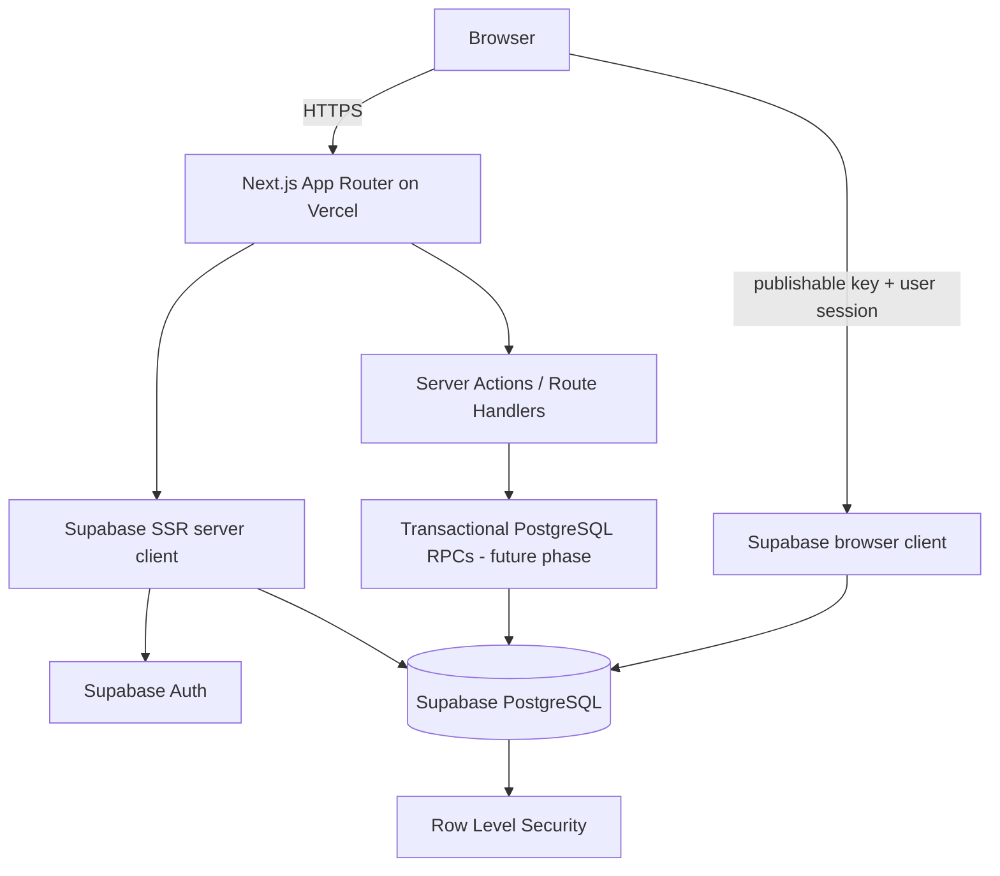

# Application Architecture

## 1. Architectural approach

Use a modular monolith built on Next.js App Router. Next.js handles the UI, server-rendered data access, server actions, and narrowly scoped route handlers. Supabase provides PostgreSQL, Auth, RLS, and (in later phases) transactional SQL functions/RPC. Vercel hosts the Next.js application.

No separate Express/Laravel/Nest service, ORM, message broker, Redis, or microservice layer is introduced.

## 2. Runtime boundaries



The browser client uses the Supabase publishable key and the signed-in user's session. The server client reads/writes the request cookies through `@supabase/ssr`. Root `proxy.ts` refreshes the session using verified claims; protected layouts/actions independently verify the session and roles.

## 3. Next.js conventions

- App Router route groups separate authentication and administration layouts.
- Server Components are the default.
- Client Components are used only for form interactivity.
- Server Actions handle the initial sign-in/sign-out flow.
- The auth callback is a Route Handler.
- `proxy.ts` refreshes Supabase cookies; it is not the authorization boundary.
- Database row visibility and write permissions remain governed by PostgreSQL RLS.

## 4. Feature boundaries

Target modules: authentication, departments, programs, sessions, semesters, students, teachers, courses, course offerings/enrollment, assessment schemes, marks, grading, results, and reports. Place business calculations in a single authoritative domain/SQL implementation rather than duplicating calculations in pages.

## 5. Current repository layout

```text
app/
  (auth)/login/       sign-in page and action
  (admin)/            protected administration layout and routes
  auth/callback/      Supabase PKCE callback
  student/dashboard/  role-protected portal placeholder
  teacher/dashboard/  role-protected workspace placeholder
components/
  academic-dashboard.tsx
  ui/                 small reusable primitives
features/dashboard/   dashboard result validation/formatting
lib/auth/             role-aware server guards and sign-out action
lib/supabase/         browser/server clients and proxy refresh helper
supabase/migrations/  versioned PostgreSQL schema and RLS migration
supabase/bootstrap/   manually controlled first-admin assignment
 tests/               Vitest and Playwright scaffolding
docs/                 architecture and operating documentation
```

## 6. Error handling and validation

Zod validates sign-in inputs and dashboard RPC data at the application boundary. Database constraints and triggers enforce relational and numeric invariants. Future mutation services must validate at the server boundary and rely on database constraints for authoritative integrity.

## 7. Deployment fit

The app uses request-scoped Supabase clients and ordinary Next.js request lifecycles; it does not rely on a persistent process or background worker. Vercel preview and production deployments must use isolated Supabase projects/databases.
