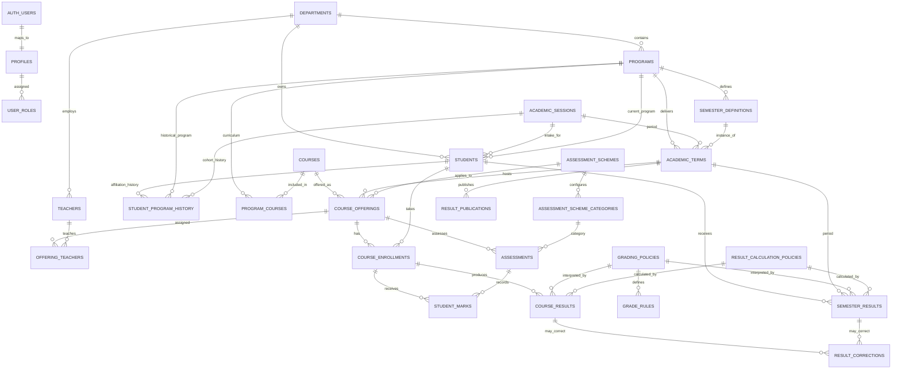

# Entity Relationship Diagram

This diagram shows the primary relationships in the first database migration. Audit and policy tables are included where they are key to result processing.

`AUTH_USERS` is managed by Supabase Auth; it is not a public application table. The full FK details and indexes are in the migration.
