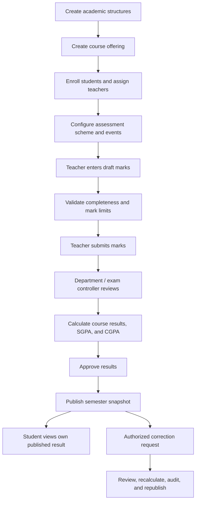

# Result Workflow

## Intended lifecycle

## States

The database result status enum includes `draft`, `submitted`, `under_review`, `approved`, `published`, and `locked`.

## Current implementation

- The data model and enum are in place.
- Marks are related to course enrollment and assessment; validation prevents invalid ranges.
- Marks linked to result records at `submitted` or later states are locked from ordinary mark updates.
- Published result snapshots reject ordinary update/delete operations.
- `result_corrections` records a scoped request structure.

The transactional submit/review/calculate/approve/publish/reopen/correction RPCs are not implemented yet. Until those exist, the lifecycle cannot be used end to end and no official result can be published by this starter.
