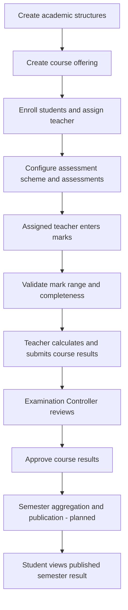

# Result Workflow

## Implemented course-result lifecycle

## Role ownership

| Role | Current responsibility |
|---|---|
| Super Administrator | Institution-wide configuration, oversight, provisioning, and exceptional administration. Can process offerings for supervised operations. |
| Department Administrator | Manages academic records, student/teacher accounts, course offerings, teacher assignments, and draft marks within the assigned department. Cannot approve course results or edit global grading policy. |
| Teacher | Enters marks only for students enrolled in the teacher's active assigned offerings. Calculates and submits course results for those offerings. |
| Examination Controller | Reads submitted course results and approves eligible results. A scoped controller is limited to the assigned department; a controller with a NULL department is global. Cannot enter marks or edit academic records. |
| Student | Reads only their own published semester-result snapshots. |

## Mark-entry rules

- The Teacher portal loads active assigned offerings, enrolled students, active assessments, category weights, current marks, and each enrollment's latest result status.
- A teacher can save pending, present, absent, or excused status for an active assessment in their assigned offering.
- Present requires a numeric mark from zero through the assessment's maximum. Other statuses require the numeric mark field to remain blank.
- The teacher cannot save marks for another teacher's offering, a non-enrolled student, an inactive assessment, or a result already submitted/under review/approved/published/locked.
- Department Administrators can also correct draft marks within their department. Super Administrators have institution-wide administrative access.
- The database RLS policies enforce these rules independently of the UI. The service-role Edge Function validates the requested user, role, enrollment, offering, assessment, range, and result state before using the caller's authenticated mark write.

## Course calculation and approval

- calculate_course_result reads the offering's assessment scheme and grading-policy version from the database. The browser does not submit the final grade or grade point.
- Within each category, the calculation is (sum of obtained marks / sum of maximum marks) × category weight. The category scores are summed and rounded using the configured course grading-policy precision.
- Required assessment marks must all be present and numeric. Missing, absent, or excused required assessments block calculation until an approved institutional policy is defined.
- The active scheme must total exactly 100%, and every weighted category must have an active assessment.
- A teacher can calculate and submit their own offering through process_course_offering. The operation skips enrollments whose latest result is already submitted, under review, approved, published, or locked.
- Marks become read-only when a course result is submitted or finalized.
- Only the Super Administrator or the Examination Controller assigned to the result's department can approve a submitted/under-review course result. Approval is enforced by both the Edge Function and approve_course_result.

## Semester-level results — not yet implemented

The semester_results table stores SGPA/CGPA snapshot fields, and the student portal can display a snapshot whose status is published. Existing rows may be demonstration snapshots.

The following operations remain planned and must not be described as implemented:

1. Aggregate approved course results into semester GPA (SGPA).
2. Rebuild cumulative GPA (CGPA) from eligible course attempts across semesters.
3. Apply university-approved repeat-course, failure, withdrawal, credit eligibility, and improvement policies.
4. Create and audit a semester-result batch, route it for approval, and publish it atomically.
5. Populate result_publications and reliably release the published snapshot to each student.

The presence of SGPA/CGPA columns or existing demonstration snapshots does not establish that these operations are available. There is no complete semester calculation/publication action in the current UI or database workflow.

## Relevant database operations

- calculate_course_result(uuid): creates a draft course-result revision using database marks, assessment scheme, and grading policy.
- submit_course_result(uuid): allows the active assigned teacher or Super Administrator to submit a draft.
- process_course_offering(uuid): calculates/submits eligible enrollments for one assigned offering (or Super Administrator).
- approve_course_result(uuid): allows the Super Administrator or Examination Controller with matching department scope to approve.

## Current status enum

The database result status enum includes draft, submitted, under_review, approved, published, and locked. The current implemented approval operation moves a submitted or under-review course result to approved; semester publication is separate and remains planned.
